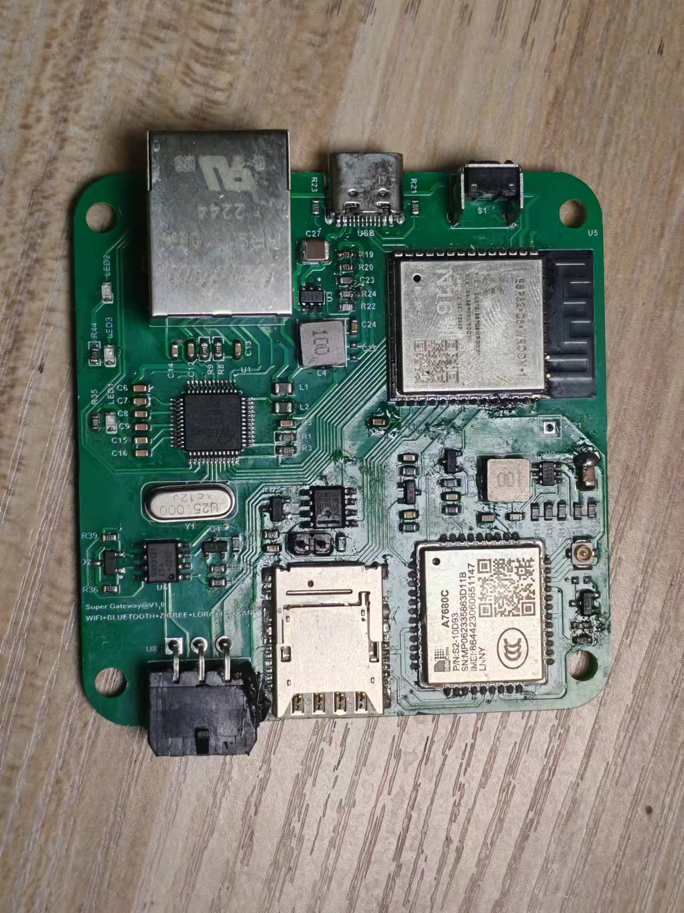
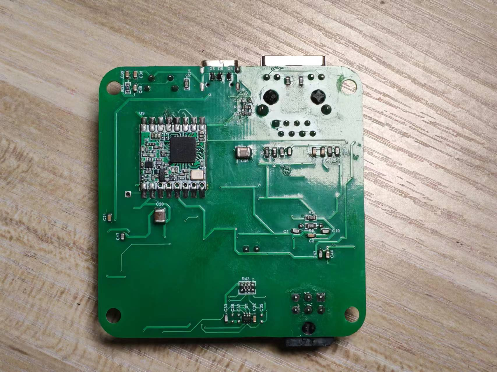
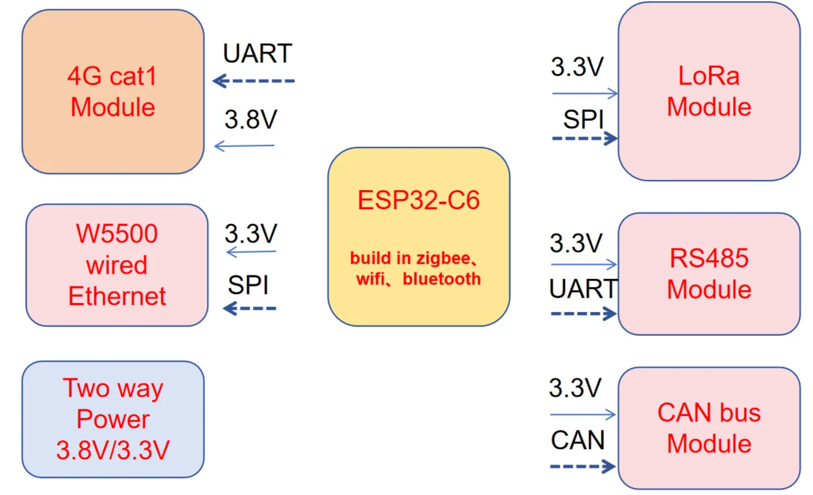
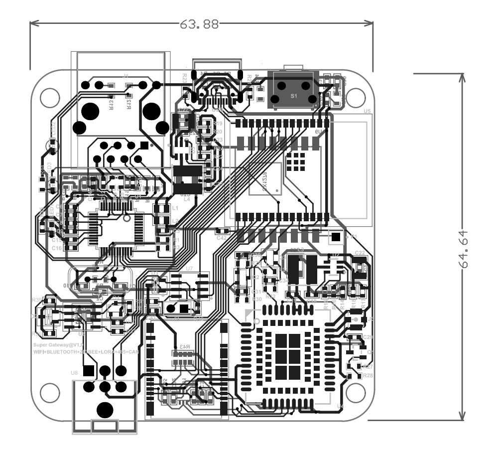
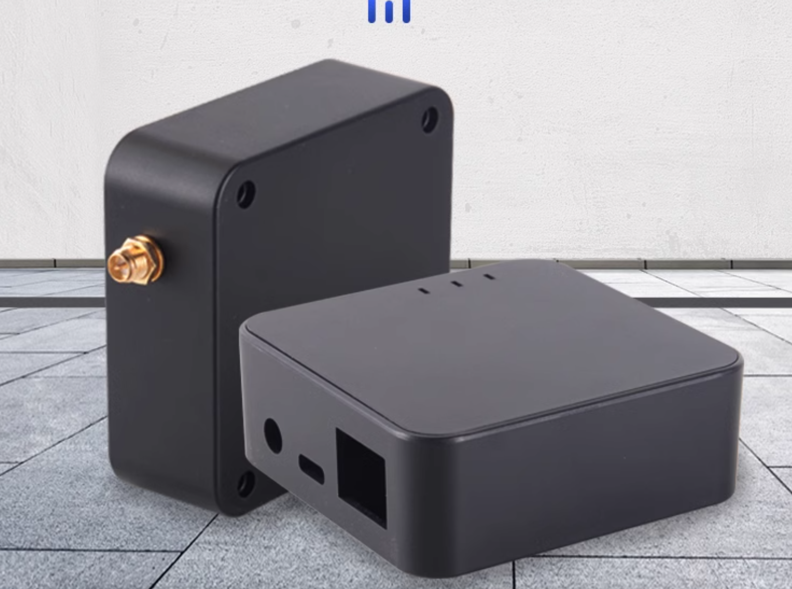

# superGateway 基于esp32-c6模组的超级网关

## 产品说明
> [!NOTE]
> 本网关融合了zigbee，wifi，bluetooth，wire ethernet，4g，Lora等多种丰富的通讯接口。
> 本网关可采集RS485总线，CAN总线的相关数据

本文文档位于 [这里](https://medium.com/@yongxiangliu/a-super-gateway-with-wired-ethernet-4g-lora-zigbee-rs485-can-bus-wifi-bluetooth-and-zigbee-c2f3361c1a2d)

## 通过本产品可以实现很多的转换，如如下单功能转换，还可以做组合转换，可实现眼花缭乱的功能，一切尽在您的创意中，或许未来的一个爆款产品就是您设计和创造的。


```
┌──────────┐ Downstream  ┌────────────────────────────────┐ 
|PC/phone  |----─┐       |           [ ESP32C6 ]          |      UP stream
└──────────┘     |       |                                |   
                 |       |   ┌──────────┐     ┌────────┐  |    ┌────────┐
┌─────────────┐  └--->   |   |   SoftAP |     |Station |  |<-- | Router |   
| WiFI Device |------>   |   └──────────┘     └────────┘  |    └────────┘
└─────────────┘          |                                |       |
┌─────────────┐          |   ┌─────────┐    ┌────────┐    |       |
| ETH Device  |------>   |   |  ETH    |    | ETH    |    |<──────┘
└─────────────┘          |   └─────────┘    └────────┘    |
                         |                                |
┌────────────┐           |   ┌────────┐                   |
| BLE Device |------->   |   |   BLE  |     ┌───────┐     |     ┌─────────┐
└────────────┘           |   └────────┘     | USART |     |<----| 4G CAT1 |
                         |                  └───────┘     |     └─────────┘
┌─────────────┐          |   ┌────────┐                   |
|zigbee device|------->  |   |zigbee  |                   |   
└─────────────┘          |   └────────┘                   | 
                         |                                |               
┌─────────────┐          |   ┌────────┐                   |
| Lora device |------->  |   | SPI    |                   |   
└─────────────┘          |   └────────┘                   | 
┌─────────────┐          |   ┌────────┐                   |
| CAN  device |------->  |   |  CAN   |                   |   
└─────────────┘          |   └────────┘                   | 
┌─────────────┐          |   ┌────────┐                   |
|RS485 device |------->  |   | UART   |                   |   
└─────────────┘          |   └────────┘                   | 
                         |                                |           
                         └────────────────────────────────┘           
                                                                      
```                               

## Features
### 正面


### 背面


### 电路板框架


### 电路板尺寸64mm*64mm


### 本电路板适配的外壳


### 本项目采用的4G模组型号及对应差别


